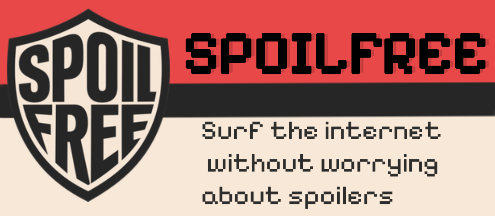
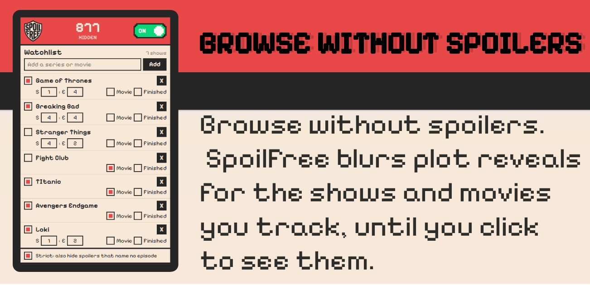
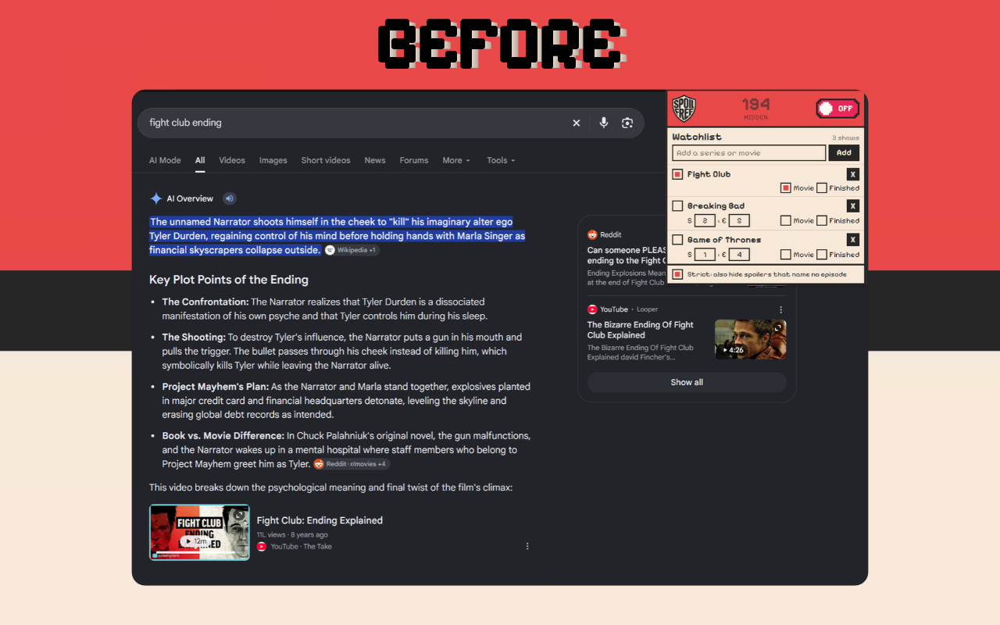
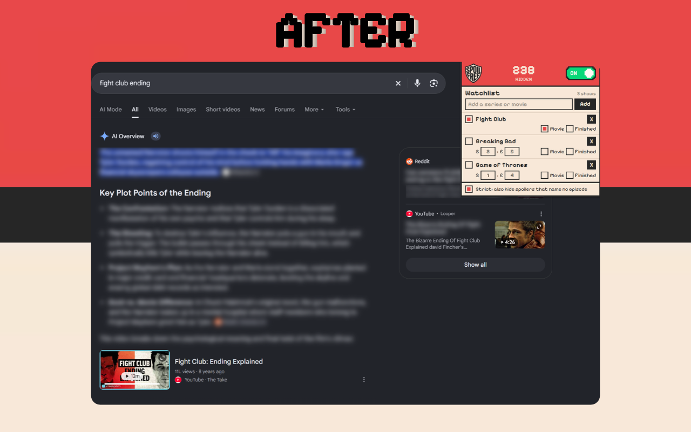

# SpoilFree

SpoilFree blurs spoilers for the shows and movies you follow, before you read them.

You add the titles you watch and how far you have got. SpoilFree reads the page as you browse and blurs text that gives away more than you have seen. Click a blurred passage to read it. Click again to hide it.

It works on Google search results and the Google AI Overview, Reddit threads, Wikipedia, blogs and forums. It keeps up as you scroll, load more results or expand sections.





## Before and after

The same Google AI Overview, without and with SpoilFree.

| Before | After |
|---|---|
|  |  |

## Features

- **Watchlist only.** Blurs only the titles on your watchlist. Everything else stays untouched.
- **Progress tracking.** Set your season and episode. Text about episodes you have already watched is left clear.
- **Movies.** Movies have no episode fields. Mark a title as a movie and the whole title is covered.
- **Strict mode.** Blurs spoilers that name no episode. Turn it off if you want fewer blurs.
- **Finished and paused titles.** Tick Finished and its blurs stop. Untick the box to pause a title.
- **Episode references.** Understands S2E5, 2x05, season 2 finale and series premiere.
- **On and off switch** in the popup header.
- **Counter** of the spoilers blurred so far.
- **Click to reveal,** click again to hide.
- **Wide coverage.** TV series, movies, anime and games. Series are matched through TVmaze. Titles it does not find there are treated like movies.

## How to use

1. Click the SpoilFree icon.
2. Type a title and press Add.
3. For a series, set the season and episode you have reached.
4. Browse as usual.

## What's new in 1.2

- Blurs only the titles on your watchlist. Before, text about anything could be blurred.
- Progress tracking per title with season and episode, a Finished box and an on and off box.
- Strict mode for spoilers that name no episode.
- Movies without season and episode fields.
- Better episode reading: series premiere, pilot, season finale, series finale.
- Better title matching: colons, dashes and apostrophes no longer break a match.
- Works on the Google AI Overview.
- Fewer wrong blurs from common character names.
- Redesigned popup: new logo, counter and switch in the header, compact layout, pixel style, hover and press states on every control.
- Faster and lighter on busy pages.
- Privacy and security: the extension asks for access only to the SpoilFree server and TVmaze, skips mail, messaging and payment sites and text boxes, and the server limits request size and rate.

## How it works

1. The content script scans visible paragraphs, list items, headings and comments, and on Google the smallest elements holding the text.
2. It keeps only text that names a title on your watchlist, or sits on a page about one.
3. Links, email addresses and long digit runs are removed from that text, and it is cut to 500 characters.
4. The background script sends it to the SpoilFree server on Hugging Face, which returns a spoiler confidence between 0 and 1.
5. The extension compares your progress with any episode named in the text. It blurs when the confidence passes a threshold: lower for movies and for text naming a later episode, higher in strict mode for text that names no episode.

Page scripts never talk to the server. Only the extension's background script does, with limits on message size and on calls per ten minutes.

## Repository structure

```
spoilfree/
├── extension/          Chrome extension (manifest, content, background and popup scripts)
├── backend/            The API that scores text, deployed as a Hugging Face Space
├── ml/                 Model training and evaluation code
├── notebooks/          Exploration and experiment notebooks
├── reports/            Evaluation results and write-ups
├── src/                Shared source code, including dataset building
├── state/              Saved state and intermediate artifacts
├── LABELLING-GUIDE.md  Rules for labelling spoiler and safe text
├── PRIVACY.md          Privacy policy
├── SECURITY.md         Security policy and how to report an issue
├── LICENSE
├── images/             README images (before.png, after.png, Spoilfree-01.png, Spoilfree-02.png)
└── SpoilFree v1.2.zip  Packaged release of the extension
```

## Install from source

1. Download or clone this repository.
2. Open `chrome://extensions` (or `brave://extensions`) and turn on Developer mode.
3. Click **Load unpacked** and select the `extension` folder.

The manifest includes a fixed `key`, so the extension keeps the same ID (`dkncpnkmklmdiageaibfgemfngclojnn`) from any folder or machine. That ID is the origin the server allows.

## Privacy

- Your watchlist and progress stay on your device.
- Only text that names a title on your watchlist, or sits on a page about one, is sent to the SpoilFree server to be scored. It is not used for anything else.
- SpoilFree does not read email, messaging or payment sites, or any text box you type in.
- Show names you add are looked up on TVmaze.
- Full policy: [PRIVACY.md](PRIVACY.md)

## Security

See [SECURITY.md](SECURITY.md) for the security model and how to report a vulnerability.

## Good to know

- Detection uses an AI model and is not perfect. It can miss a spoiler or blur a harmless line. Click to reveal anything you want to read.
- It works best on English text.

## Labelling

Training data is labelled as spoiler or not spoiler by the rules in [LABELLING-GUIDE.md](LABELLING-GUIDE.md).

## Contact

SpoilFree is made by one developer. Feedback and bug reports are welcome: https://github.com/salujadivyam
